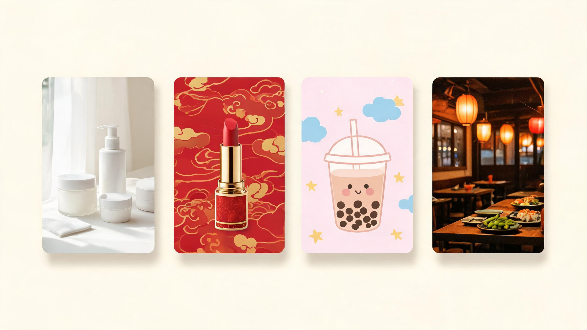
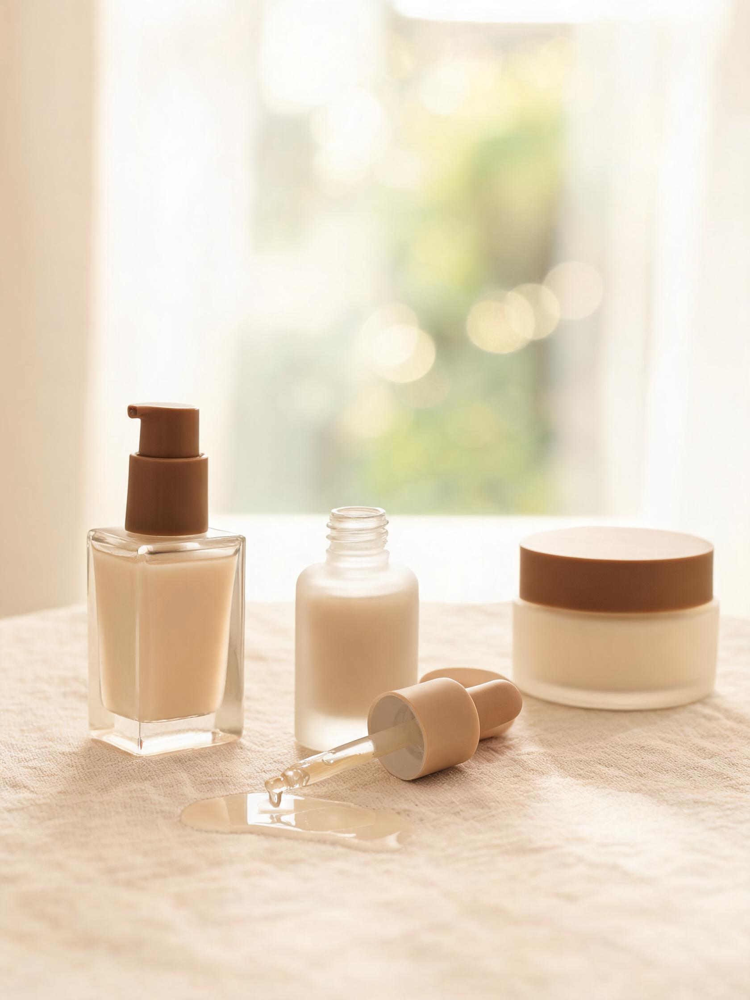
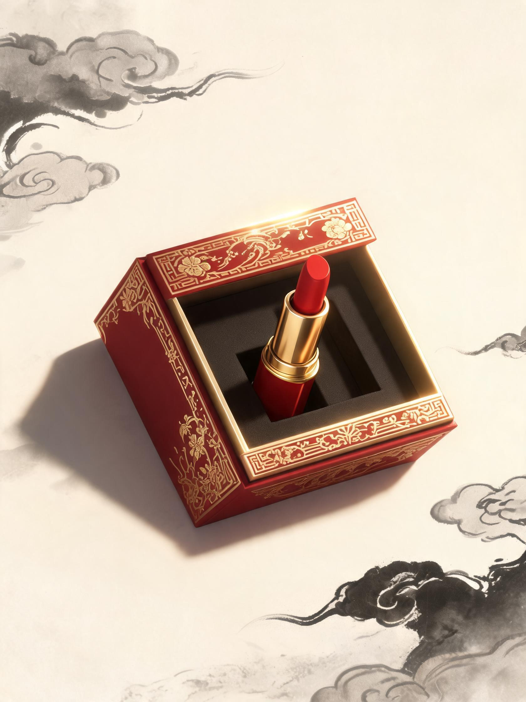
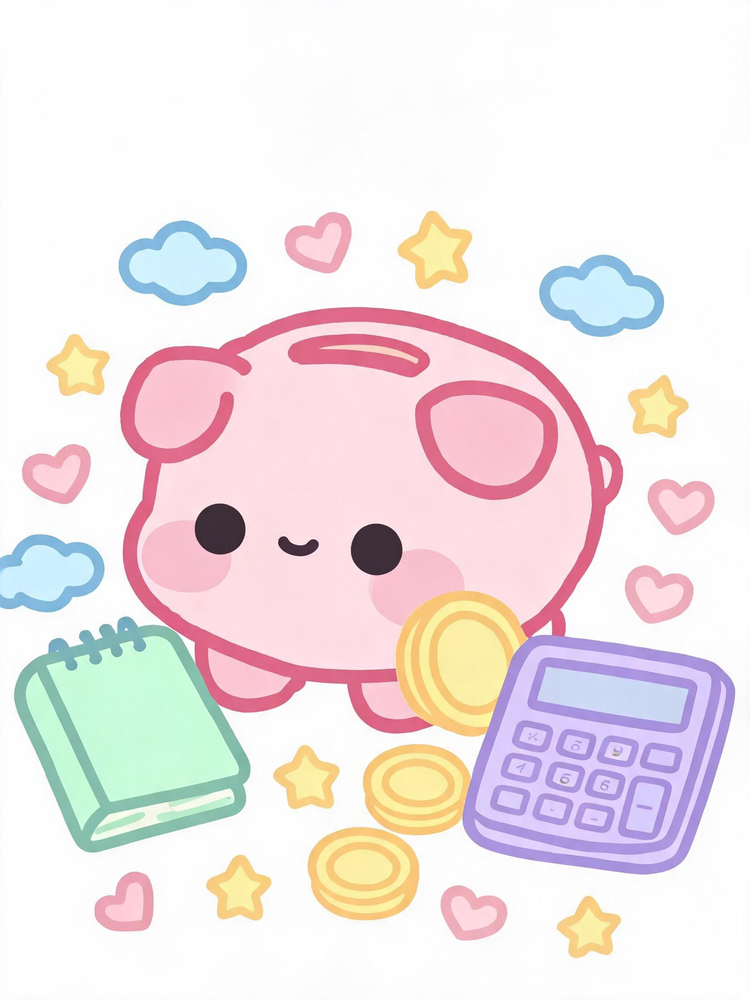
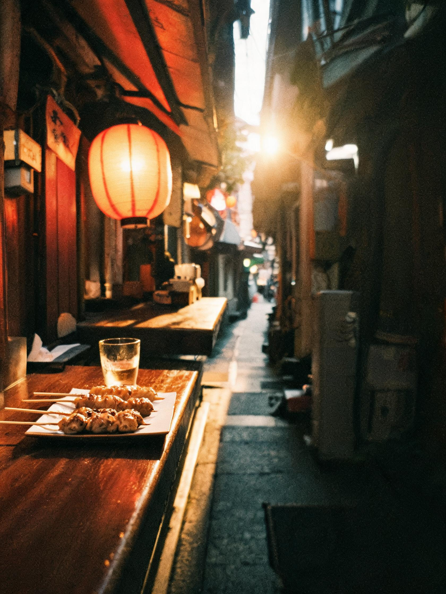

# yy-rednote-img



  

一句话进去，一组风格统一的小红书配图出来。8 套风格预设管配色构图，4 家出图接口轮流兜底，每张图落地前先过一遍体检。

## 出图示例

下面这 4 张就是本仓库的 Prompt 直接生成的，没修图。Prompt 由 `scripts/generate.py --dry-run-prompts` 输出，原样喂给出图模型：

| `ins-aesthetic` | `neo-chinese` | `cute-illustration` | `emotional-daily` |
|---|---|---|---|
|  |  |  |  |
| 护肤 · 穿搭 · 生活方式 | 节日 · 茶饮 · 文创 | 知识卡 · 教程 · 儿童内容 | 美食 · 探店 · 旅行 |

## 这个工具解决什么问题

用 AI 给小红书出图，麻烦不在「能不能画」，而在这几件事上反复翻车：

| 翻车现场 | 这里的做法 |
|---|---|
| 同一篇笔记，几张图各画各的风格 | 8 套预设（`styles/presets.json`）把调色板、构图、灯光、镜头写死，5 个 Hex 色值一个不许超 |
| 水印、六指、乱码字 | 30+ 条通用负面词 + 预设专属负面词 + 你自己加的 exclude，每次调用全部带上 |
| 某个出图接口抽风，整篇卡住 | TRAE 内置 → Seedream 插件 → DALL·E 3 → FLUX，一家连挂 3 次自动换下一家 |
| 图传到首页才发现被裁 | 3:4 / 1:1 / 4:3 / 9:16 提前映射到各家最接近的原生尺寸 |
| 下载下来的图是坏的 | 每张查 PNG 文件头、体积下限 50KB、比例误差 < 1%，不合格进 `_failed/` 重来 |
| 上次那张挺好的，再也画不出来 | `manifest.json` 记下每张图的供应商、种子、Prompt、预设，照着能复现 |

## 两种用法

- **智能体模式（默认，零配置）**：脚本先写 `tasks.json`，宿主（TRAE / Claude Desktop / Codex 等）用自己的出图工具逐张生成，脚本最后校验、写 manifest。
- **API 模式（`--mode api`）**：环境变量里配了 `OPENAI_API_KEY` 或 `FAL_KEY` 时，脚本直接调 DALL·E 3 / FLUX。

两种模式共用同一套 Prompt 逻辑，出图效果一致。

## 安装

发给任意支持 Skill 的智能体一句话即可：

```text
请从此 URL 安装 Skill：https://github.com/ivercurry99/yy-rednote-img
```

或者命令行：

```bash
npx skills add ivercurry99/yy-rednote-img
# 或者手动：
git clone https://github.com/ivercurry99/yy-rednote-img.git <你的技能目录>/yy-rednote-img
```

硬依赖只有 Python 3.10+。Pillow 装了更好（多一条图片校验路径），不装也能跑——脚本内置了纯 Python 的 PNG 解析兜底。

## 跑一遍看看

先别急着花额度，`--dry-run-prompts` 会把每张图的完整 Prompt 打印出来：

```bash
cd yy-rednote-img
python scripts/generate.py ^
  --topic "20+ 夏天油皮护肤三步曲" ^
  --cards 4 ^
  --style ins-aesthetic ^
  --ratio 3:4 ^
  --dry-run-prompts
```

确认 Prompt 没问题，去掉 `--dry-run-prompts` 就是正式生成。产物在 `output/<run-id>/` 下：

```text
output/20261025-013000-abc123/
├── cover.png  card_1.png  card_2.png  card_3.png
├── manifest.json     # 每张图的供应商 / 种子 / Prompt / 预设
└── _failed/          # 校验没过、被丢弃的图
```

想微调画面，直接用参数追加，不用改配置文件：

```text
--keywords "防晒霜, 膏体涂抹, 滴管特写"
--audience "20-28 岁东亚女生"
--mood "治愈、奶油感"
--exclude "不露脸、不要手"
```

## 8 套风格预设

完整参数在 `styles/presets.json`，自定义追加方法见 `references/prompt-engineering.md`：

| `--style` | 长相 | 适合 |
|---|---|---|
| `ins-aesthetic` | 奶白、窗边柔光、低对比 | 护肤 · 穿搭 · 生活方式 |
| `clean-minimal` | 纯白无缝、俯视、硬阴影 | 单品主图 · 电商 |
| `neo-chinese` | 朱砂红 + 金、水墨、国潮纹样 | 节日 · 茶饮 · 文创 |
| `y2k-funky` | 品红青蓝、铬金属、闪光灯 | 校园 · 潮流 · 夏日 |
| `magazine-editorial` | 胶片颗粒、大片布光、留文案区 | 深度长文 · 观点笔记 |
| `emotional-daily` | 暖调胶片、手持抓拍 | 美食 · 探店 · 旅行 |
| `product-flatlay` | 正俯视平铺、麻布背景 | 开箱 · 合集 · 步骤 |
| `cute-illustration` | 粗描边、马卡龙色、扁平矢量 | 知识卡 · 教程 · 儿童 |

## 测试与贡献

```bash
pip install -r requirements.txt
pytest tests/test_generate.py -v
```

核心逻辑是纯函数，28 个测试全部离线可跑。欢迎 issue 提场景，新增预设记得在 `tests/test_generate.py` 和 `evals/evals.json` 里各补一条用例。

## 许可证

MIT © 2026 ivercurry99
