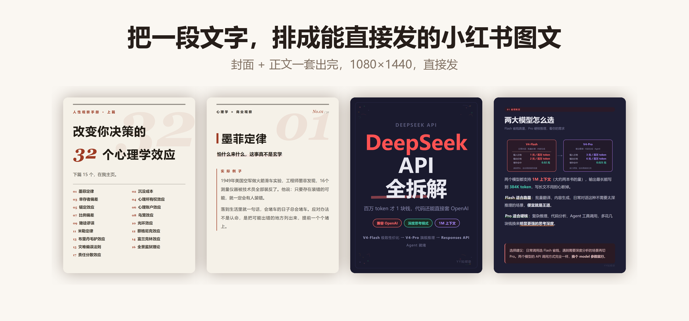
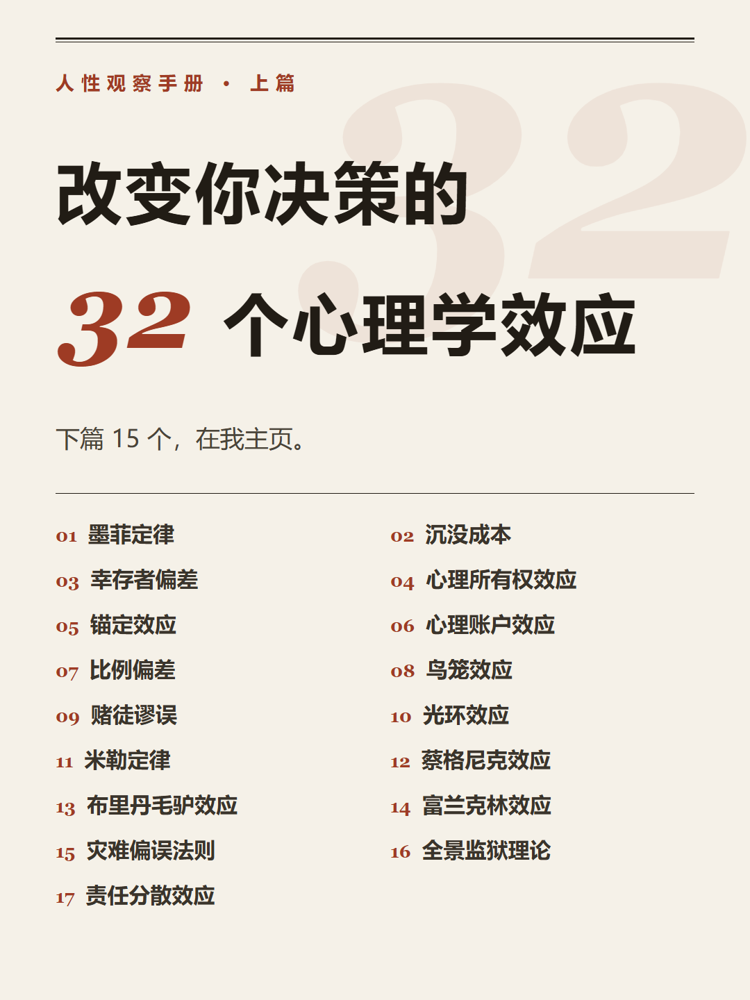
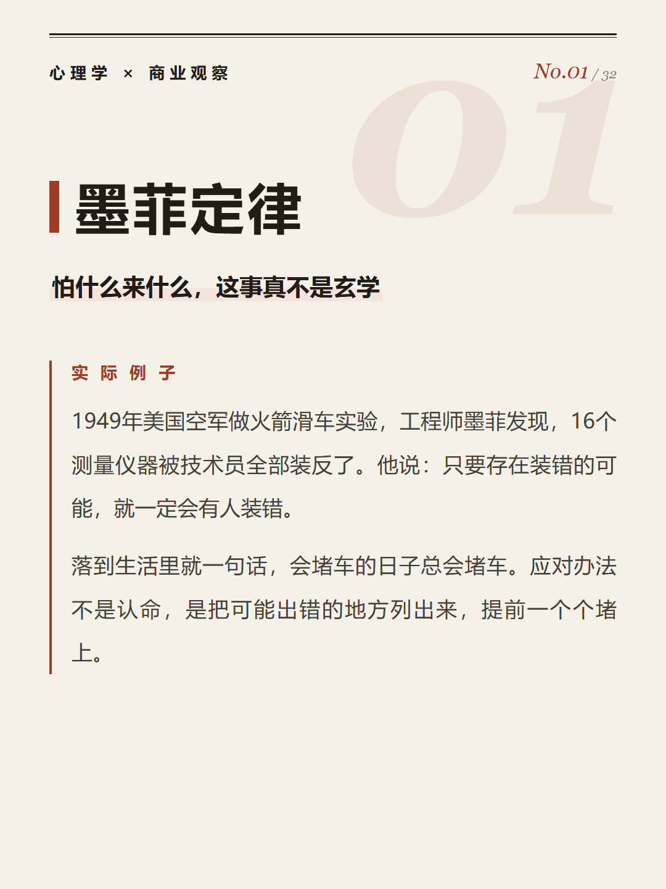
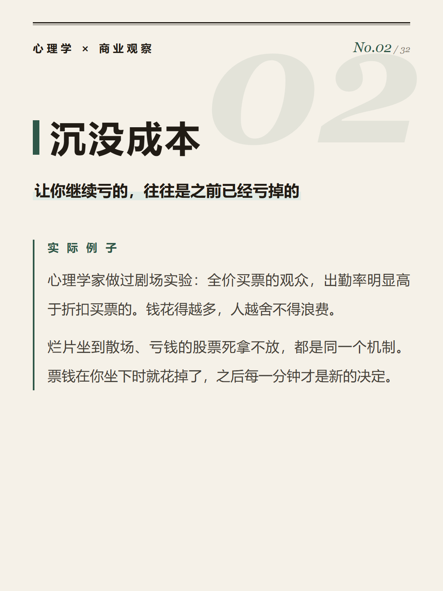
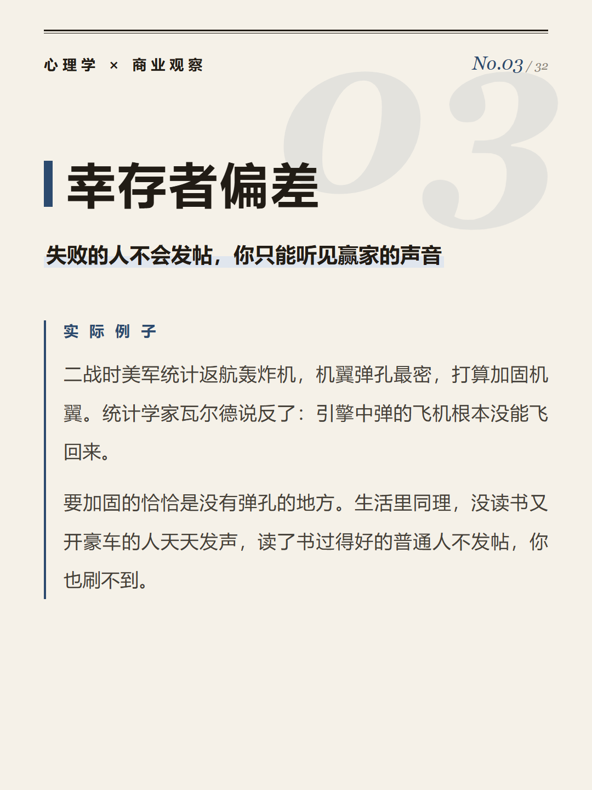
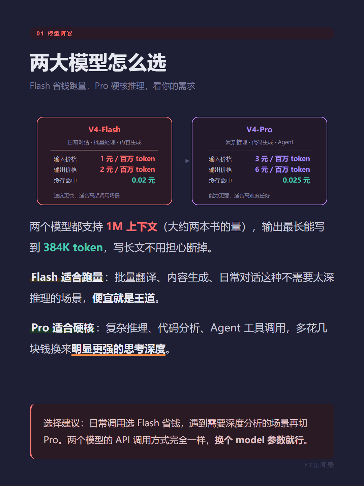
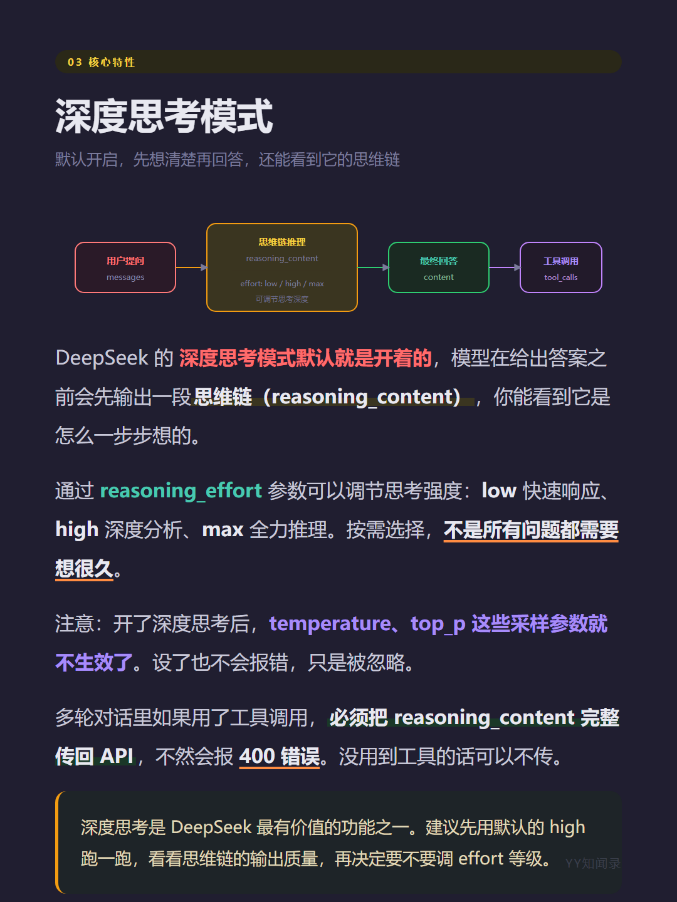
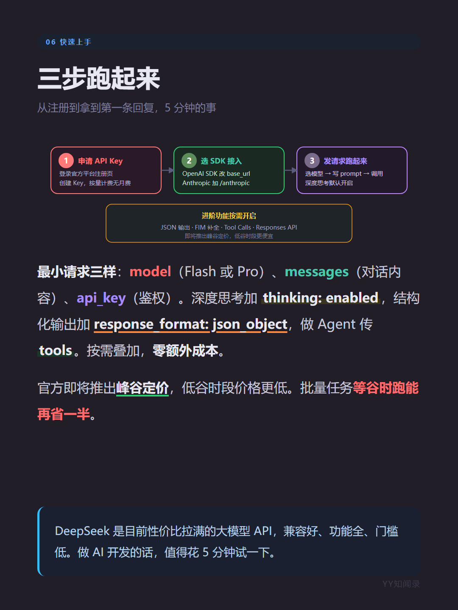

# yy-rednote-img



  

这个技能把一段中文文字排成一组可以直接发布的小红书图文：一张封面加若干张正文，每张 1080×1440。文字由系统字体排版，不经过图像模型，所以不会出现错字和糊字。

## 示例

下面两组是我之前实际发布过的图文，封面负责让人停下来，后面三张各讲一件事。

**心理学效应 · 32 个定律（上篇）**

| 封面 | 01 墨菲定律 | 02 沉没成本 | 03 幸存者偏差 |
|---|---|---|---|
|  |  |  |  |

**DeepSeek V4 API 全拆解**

| 封面 | 01 两大模型怎么选 | 02 深度思考模式 | 03 快速上手 |
|---|---|---|---|
|  |  |  |  |

## 用法

把准备好的文字交给技能，说明要拆成几张，它会挑一套配色，写好版式，调用本机浏览器截成图片。也可以自己运行：

```bash
python scripts/card.py --input examples/early-rising.json --out output/cards --theme ins-aesthetic
```

内容用一份 JSON 描述，包括标题、副标题、正文段落、要点列表和金句框。`examples/` 里有 4 份可以直接跑。

## 配色

| `--theme` | 观感 | 适合 |
|---|---|---|
| `ins-aesthetic` | 奶白底、棕调强调色 | 生活方式 · 护肤 · 日常分享 |
| `clean-minimal` | 纯白、黑白灰 | 极简 · 工具 · 干货 |
| `neo-chinese` | 朱砂红底 + 描金 | 节日 · 传统文化 · 茶与酒 |
| `y2k-funky` | 浅紫底、荧光粉 | 潮流 · 校园 · 年轻向 |
| `magazine-editorial` | 米灰底、宋体、砖红 | 书评 · 影评 · 长文 |
| `emotional-daily` | 暖黄底、陶土色 | 日记 · 旅行 · 情绪 |
| `product-flatlay` | 亚麻灰底、橄榄绿 | 好物 · 清单 · 开箱 |
| `cute-illustration` | 粉底、圆角大 | 教程 · 儿童 · 知识卡 |

配色写在 `scripts/card.py` 的 `THEMES` 里，改一组色值就能加自己的风格。

## 安装与环境

```bash
npx skills add ivercurry99/yy-rednote-img
git clone https://github.com/ivercurry99/yy-rednote-img.git <你的技能目录>/yy-rednote-img
```

需要 Python 3.10+ 和本机已装的 Chrome 或 Edge，不用安装 Python 包。找不到浏览器时，用 `CHROME_PATH` 指定可执行文件路径。

## AI 配图（可选）

封面需要照片或插画质感时，可以另外调用配图脚本。脚本准备了 8 套风格预设，按 TRAE 内置、Seedream、DALL·E 3、FLUX 的顺序切换供应商。

这类图片由模型生成，效果取决于所调模型的能力：同样的提示词，换一个模型或换一次运行，画面可能不一样。文字卡片不受影响。

```bash
# 先空跑看提示词，不花额度
python scripts/generate.py --topic "夏天油皮护肤三步曲" --cards 4 --style ins-aesthetic --ratio 3:4 --dry-run-prompts

# 正式生成
python scripts/generate.py --topic "夏天油皮护肤三步曲" --cards 4 --style ins-aesthetic --ratio 3:4
```

比例映射、图片校验和降级细节写在 `references/` 里。直连 DALL·E 3 或 FLUX 时才需要配 Key。

## 测试

```bash
pytest tests/ -v
```

`tests/test_card.py` 覆盖字号计算、HTML 转义、内容校验和图片尺寸检查，不依赖浏览器；`tests/test_generate.py` 覆盖提示词拼接、尺寸映射和供应商降级，全部离线。

## 许可证

MIT © 2026 ivercurry99
